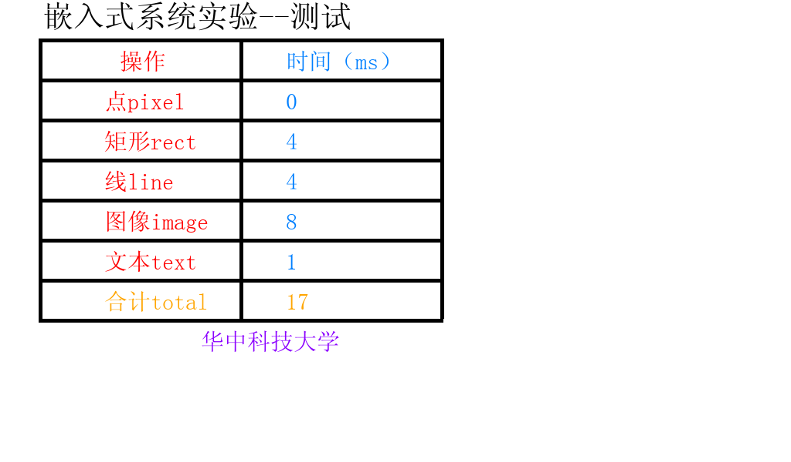
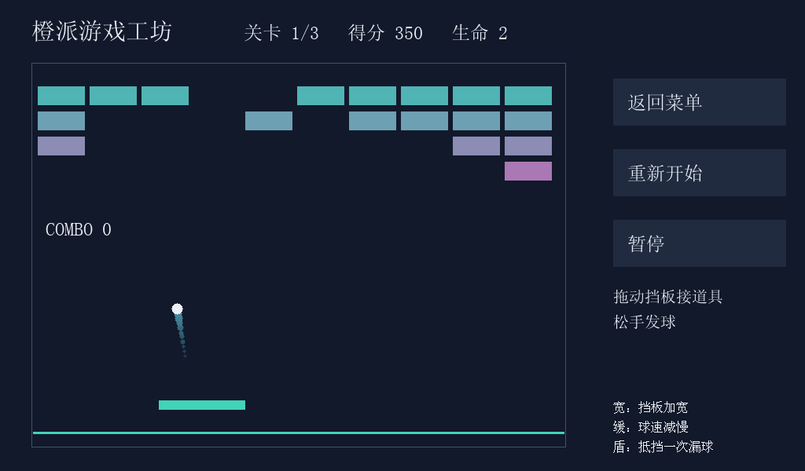

# 华中科技大学计算机学院24届嵌入式系统实验

Orange Pi 4 LTS 上的六个嵌入式实验：系统烧录、基础绘图、图片文字显示、多点触摸、蓝牙串口，以及五子棋、2048、三关打砖块组成的游戏工坊。

**2026-11-07 更新：报告正文 20 页，封面和目录另计；补齐游戏工坊 v2、历史优化代码、实验材料和复现说明。** 公开报告已去掉姓名、学号、班级、电话和邮箱。课程镜像、字体、SDK、外部库和往届报告不打包分发。

## 先找需要的内容

- [实验报告 PDF](reports/embedded-systems-report.pdf) · [可编辑 DOCX](reports/embedded-systems-report.docx)
- [报告配图、图注、CSV 表格](reports/README.md)
- [快速开始与依赖](docs/quick-start.md)
- [连接开发板、SSH 与排障](docs/connection-troubleshooting.md)
- [实验三优化与复杂度分析](docs/lab3-optimization.md) · [历史版本索引](archive/README.md)
- [最新游戏工坊 v2](labs/arcade-v2/README.md) · [直接浏览游戏源码](projects/game-workshop-v2/README.md)
- [测试记录和状态](docs/status-and-updates.md) · [来源说明](THIRD_PARTY_NOTICES.md)

## 六个实验

| 实验 | 代码入口 | 实际记录 |
| --- | --- | --- |
| 一 系统烧录 | [Hello](labs/lab1/README.md) | 烧录、SSH、程序运行完成，助教已验收 |
| 二 基础绘图 | [矩形、直线](labs/lab2/README.md) | 点、矩形、线测试通过，助教已验收 |
| 三 图片文字 | [基础版](labs/lab3/README.md) / [v10 直接矩形版](labs/v10/README.md) | 最快 17 ms；三轮 22 / 21 / 17 ms |
| 四 多点触摸 | [五指画板](labs/lab4/README.md) | 五指五色连续粗线与清屏实测正常 |
| 五 蓝牙通信 | [SPP 双向收发](labs/lab5/README.md) | 中文接收、hello 发送、断开重连实测正常 |
| 六 综合实验 | [原五子棋](labs/lab6/README.md) / [游戏工坊 v2](labs/arcade-v2/README.md) | 五子棋对局、悔棋实测正常；v2 已 ARM 编译、运行及抓图 |

实验三至六的运行记录已整理；正式验收状态以 [STATUS.json](STATUS.json) 为准，未把程序运行自动记为助教验收。

## 取得可构建源码

实验一可独立编译。其余实验基于课程框架，采用 `changes.patch` 与带 SHA256 的 `profile.json` 保存修改，重建时需要匹配的课程原工程。目录中不附课程字体与二进制库。

```sh
# 在已安装 Python 3 的电脑或开发板执行，输出目录必须尚不存在。
python3 tools/materialize.py --profile arcade-v2 --course /path/to/lab-st-2026 --output .work/arcade-v2 --include-assets

# 在开发板上编译运行游戏工坊。输入节点按实际设备修改。
bash .work/arcade-v2/build-on-board.sh /path/to/lab-st-2026
bash .work/arcade-v2/run-on-board.sh --touch /dev/input/event2
```

基础实验可选 `lab2`、`lab3`、`lab4`、`lab5`、`lab6`；优化版选 `v10`。`python3 tools/materialize.py --help` 列出全部 35 个源码快照。新输出目录与课程原工程相互独立。

## 实验三的实测结果

| 版本或测试时间 | 三轮总成绩 / ms | 中位数 / ms |
| --- | --- | --- |
| 早期字模缓存与 O3 | 160 / 155 / 173 | 160 |
| 同轮原接口基线 | 47 / 46 / 47 | 47 |
| v9 字模修正版 | 27 / 27 / 25 | 27 |
| v10 字模修正版 | 28 / 25 / 28 | 28 |
| v10 直接矩形组合 | 22 / 21 / 17 | 21 |
| 2026-11-05 同部署版本复测 | 58 / 19 / 20 | 20 |



17 ms 是课程七个绘制阶段整数毫秒耗时之和，未包含图片解码、程序启动和屏幕刷新。优化版使用显式批量接口，历史 155 ms 测试的 CPU 和编译配置也不同；完整比较见优化说明与原始日志。首轮 58 ms 保留在复测表中。



## 仓库结构

| 目录 | 内容 |
| --- | --- |
| `labs/` | 各实验与当前推荐版本的补丁、重建配置和说明 |
| `projects/` | 游戏工坊 v1、v2 的新增源码，便于在线阅读 |
| `archive/` | v1–v10 等历史源码快照、阶段笔记和历史辅助脚本 |
| `research/` | PNG、文字、画点、覆盖消除、短区间等优化研究与测试 |
| `reports/` | 公开报告、插图、图注和表格 |
| `results/` | 板测日志、截图与主机测试记录 |
| `tools/`、`tests/` | 当前维护的重建工具与仓库验证 |

历史笔记可能含当时的“待板测”状态；最新情况看本 README 与状态文件。历史脚本保留研究过程，运行前需调整机器路径和依赖；它们不是快速开始入口。文件来源和公开副本哈希见 [PUBLICATION_MANIFEST.json](PUBLICATION_MANIFEST.json)。

## 验证

```sh
python3 -m unittest discover -s tests -v
python3 tools/check-repository.py
python3 tools/test-game-core.py --cc gcc
make -C labs/lab1
./labs/lab1/out/lab1
```

仓库检查、主机规则测试与真实触摸/蓝牙是不同验证。板测证据分别保存，不用电脑模拟成绩代替板端测速。

请结合当期任务书理解代码与测试方法，再完成自己的实验。开发和整理使用了 AI 辅助；引用与授权范围见来源说明。
