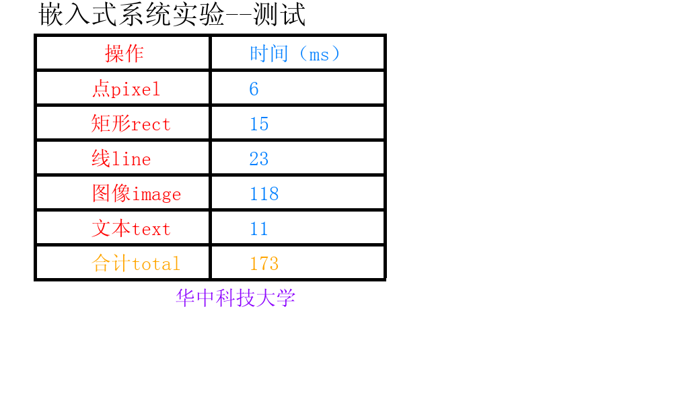

# 华中科技大学计算机学院24届嵌入式系统实验

华中科技大学嵌入式系统实验的实现、复现步骤与排障记录。硬件为 Orange Pi 4 LTS，内容包括 Linux 图形、图片与文字、多点触摸、蓝牙串口和触屏五子棋候选。

**状态快照：2026-10-19。** 实验一、二已获用户确认验收；实验三、四、五、六已有实测，尚未记录正式验收。实验报告待写完后补充。

## 先看这些

- [快速开始与依赖](docs/quick-start.md)
- [电脑连接开发板、SSH 与排障](docs/connection-troubleshooting.md)
- [实验三优化过程与测量口径](docs/lab3-optimization.md)
- [各实验状态与验收后更新步骤](docs/status-and-updates.md)
- [来源、引用和公开范围](THIRD_PARTY_NOTICES.md)

## 实验导航

| 实验 | 实现与说明 | 实际状态 |
| --- | --- | --- |
| 一 | [烧录、启动和 Hello](labs/lab1/README.md) | 用户反馈已验收 |
| 二 | [矩形和直线](labs/lab2/README.md) | 用户反馈已验收 |
| 三 | [图片、字模、文字与测试](labs/lab3/README.md) | 基线已板测，验收待反馈 |
| 四 | [五指画板](labs/lab4/README.md) | 功能已板测，验收待反馈 |
| 三 v9 | [PNG、文字与几何优化候选](experiments/lab3-v9/README.md) | 原始候选保留，详见状态记录 |
| 五 | [经典蓝牙 SPP](labs/lab5/README.md) | 实测双向收发与重连通过，待验收 |
| 六 | [触屏五子棋](labs/lab6/README.md) | 实测对局、悔棋与存档恢复通过，待验收 |

已实现、离线测试、真实板测、助教验收分别记录。完整状态见 [STATUS.json](STATUS.json)。

## 代码组织

实验一提供独立源码；实验二至六、v9 与 [v10板测版](labs/v10/README.md) 以可读的 `changes.patch` 和带哈希校验的 `profile.json` 记录修改。你需要从课程渠道取得匹配的原始工程，工具会重建到新的独立目录，不修改原工程或已有输出目录。

```sh
python3 tools/materialize.py --profile lab3 --course /path/to/original-course --output .work/lab3 --include-assets
make -B -C .work/lab3/lab3 CC=gcc CFLAGS='-Wall -O3'
make -B -C .work/lab3/test CC=gcc CFLAGS='-Wall -O3'
```

这些构建命令在开发板执行；显示程序运行前按快速开始检查屏幕和桌面状态。需要匹配的课程工程与随课外部库，不能只复制 `.c` 文件就假定可运行。

## 实测结果

实验三字模缓存配合 `-O3` 的三次真实板测为 **160 / 155 / 173 ms，中位数 160 ms**。155 ms 有完整日志，没有该轮独立截图；下图对应 173 ms。



最新[v10直接矩形版](labs/v10/README.md)三轮 **22 / 21 / 17 ms，中位数21ms**。同配置原接口基线47 / 46 / 47ms。旧155ms的CPU和编译配置不同，不能把全部提升归因于算法。优化版使用显式批量接口；公开原始口径和真实分项，不采用估计值。


## 验证本仓库

```sh
python3 -m unittest discover -s tests -v
python3 tools/check-repository.py
make -C labs/lab1
./labs/lab1/out/lab1
```

这里的自动检查只验证仓库结构、重建工具和普通主机可执行的 Hello，不等于 ARM、触摸或蓝牙验收。历史绘图测试摘要单独存放于 [results/host](results/host/README.md)。GitHub Actions 配置已准备，尚未在远端执行。

## 使用与贡献

请先理解实现，再对照当期任务书完成实验。不同年份镜像和硬件可能不同；报告性能时附版本、flags、计时范围及多轮分项数据。参考他人资料时保留来源，不把他人的测试与验收当成本项目结果。

本地原始材料、历史版本和归档另外完整保留。PPT、系统镜像、字体文件、SDK、模型和他人报告未打包进仓库；公开范围与许可证状态见来源说明。开发中使用过 AI 辅助，可靠性以明确列出的测试为依据。
