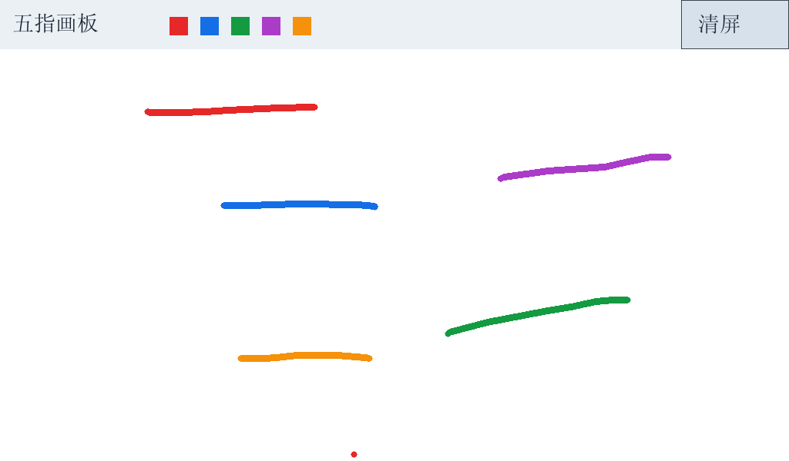

# 实验四：五指画板

状态：真实单指绘制、五指五色连续粗轨迹、清屏均已由用户确认；助教验收待反馈。

```sh
python3 tools/materialize.py --profile lab4 --course /path/to/original-course --output .work/lab4 --include-assets
make -B -C .work/lab4/lab4 CC=gcc CFLAGS='-Wall -O3'
cd .work/lab4/out
./lab4 --touch /dev/input/eventX
```

`eventX`须替换为实际触摸节点，参见[连接与设备排查](../../docs/connection-troubleshooting.md)。不要重复启动多个画屏程序。

本版保留已验证的实验三字模缓存，新增触点协议和绘制模块。顶部色块表示触点颜色，**不提供单指选色**；每个触点按编号分配颜色。

验收：单指快速画线、五指同时拖动后抬起，确认五条不同颜色、连续且较粗的轨迹；点击右上角清屏。



该图是从真实开发板framebuffer读取的图像，不是屏幕实物照片。运行状态记录见[板测结果](../../results/board/lab4-20261015.json)。
