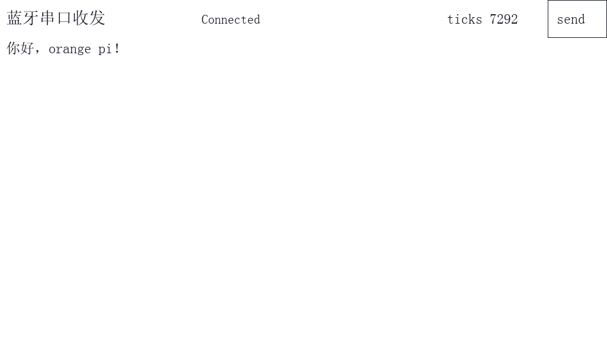

# 经典蓝牙 SPP

2026-10-19 已完成真实开发板试运行，尚待助教验收。代码含实际板测采用的 FreeType MONO 字模转换修复。

```sh
python3 tools/materialize.py --profile lab5 --course /path/to/original-course --output .work/lab5 --include-assets
make -B -C .work/lab5/lab5_bt CC=gcc
cd .work/lab5/out
sudo ./lab5_bt --touch /dev/input/eventN
```

请先按[快速开始](../../docs/quick-start.md)检查依赖、桌面与 framebuffer。eventN 必须用当前实际触屏设备替换，不能固定为某次实验的编号。

实测范围见[本次记录](../../results/board/trial-20261019.json)。完整课程素材需自行取得，仓库不附字体或外部库。

手机使用经典 SPP 蓝牙串口应用。板端需要 BlueZ 的 SPP 服务记录（RFCOMM channel 1）和 `sudo rfcomm -r watch 0 1` 监听，应用等待 `/dev/rfcomm0`。
配对时保持 `bluetoothctl` 的 agent 活跃，核对手机与板端验证码后确认；关闭会话会移除临时 agent。不要公开手机地址、配对码或自动信任任意设备。
实测：手机中文正常显示，触屏 send 后手机收到 hello，应用内断开重连后双向收发正常。Linux PTY 测试另有日志，它不替代无线实测。


