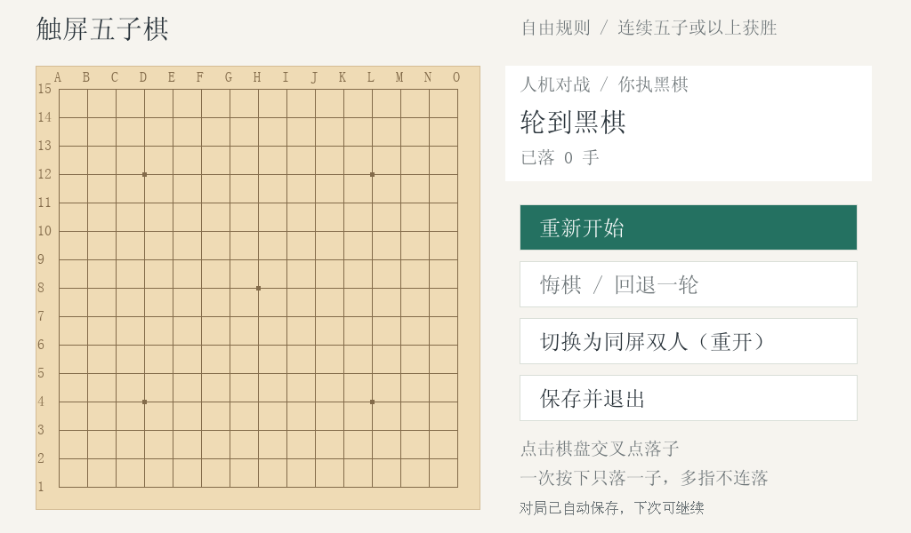

# 触屏五子棋

2026-10-19 已完成真实开发板试运行，尚待助教验收。代码含实际板测采用的 FreeType MONO 字模转换修复。

```sh
python3 tools/materialize.py --profile lab6 --course /path/to/original-course --output .work/lab6 --include-assets
make -B -C .work/lab6/lab6_gomoku CC=gcc
cd .work/lab6/out
sudo ./lab6_gomoku --touch /dev/input/eventN
```

请先按[快速开始](../../docs/quick-start.md)检查依赖、桌面与 framebuffer。eventN 必须用当前实际触屏设备替换，不能固定为某次实验的编号。

实测范围见[本次记录](../../results/board/trial-20261019.json)。完整课程素材需自行取得，仓库不附字体或外部库。

已实测落点、电脑应答、悔棋、正常退出及恢复6手存档。AI 对局与存档不等同于所有 UI 边界都已人工遍历；正式验收后再补记录。


