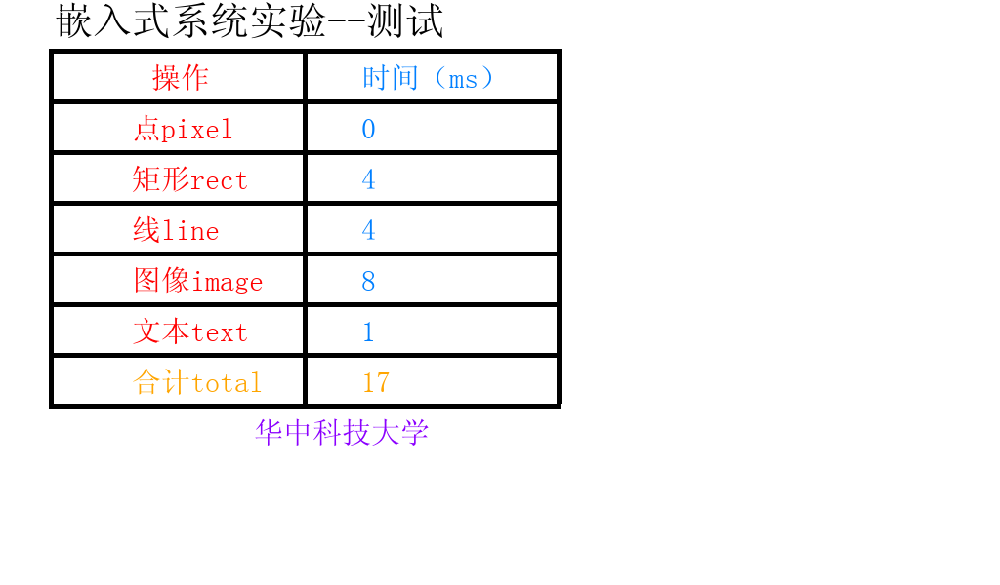

# 实验三：v10 直接矩形板测版

三轮22/21/17ms，中位数21ms，最佳17ms；不能声称稳定17ms。原版与v9另行保留。

```sh
python3 tools/materialize.py --profile v10 --course /path/to/original-course --output .work/v10 --include-assets
python3 .work/v10/board_compare.py --project /path/to/original-course --variants baseline,v9-sprint,v10-sprint --runs 3 --threads 2 --threshold 4096 --lto --native-cpu --vector-report --no-stats --governor performance --bind fast --active-wait
```

在板上安装所需开发库后执行；先检查 framebuffer 和桌面冲突。对照工具运行原生正确性检查。性能设置为临时设置，结束时恢复；不要断电中断。
本版矩形恢复直接填充，其余沿用v10；真实FreeType小字模需展开MONO/GRAY2/GRAY4，避免把压缩位图当8位alpha。
使用显式批量接口，计算仍在计时内；课程七段计时不含解码、刷新和sleep。是否接受该接口由当期助教决定。
详细分项和环境见[实测数据](../../results/board/trial-20261019.json)。0ms为整数计时分辨率，不代表零工作。


